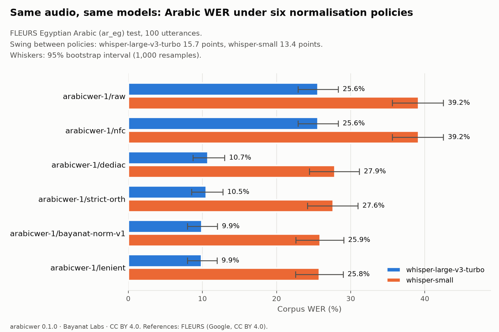

# Case study: how far Arabic WER moves with the normalisation policy

Data: FLEURS Egyptian Arabic (`google/fleurs`, config `ar_eg`, test split, revision `70bb2e84b976b7e960aa89f1c648e09c59f894dd`), rows 1-100 of 428 in file order, 18.8 minutes of audio. References: the `raw_transcription` field (Google, CC BY 4.0). Hypotheses: produced by Bayanat Labs on a laptop CPU with the open models below (released CC BY 4.0 in `hyps/`). All numbers in this file are computed by `casestudy/score.py` with arabicwer 0.1.0.

| Model | Weights used | Runtime | Decoding |
|---|---|---|---|
| `openai/whisper-large-v3-turbo` | `mobiuslabsgmbh/faster-whisper-large-v3-turbo@0a363e9161cbc7ed1431c9597a8ceaf0c4f78fcf` | faster-whisper 1.2.1, CTranslate2 4.8.3, CPU, int8 | language=ar, task=transcribe, beam_size=5, temperature=0.0, vad_filter=False, condition_on_previous_text=False |
| `openai/whisper-small` | `Systran/faster-whisper-small@536b0662742c02347bc0e980a01041f333bce120` | faster-whisper 1.2.1, CTranslate2 4.8.3, CPU, int8 | language=ar, task=transcribe, beam_size=5, temperature=0.0, vad_filter=False, condition_on_previous_text=False |

## Corpus WER and CER under each policy

| Policy | whisper-large-v3-turbo WER (95% CI) | whisper-large-v3-turbo CER | whisper-small WER (95% CI) | whisper-small CER |
|---|---|---|---|---|
| `arabicwer-1/raw` | 25.57% (22.88%-28.33%) | 6.26% | 39.17% (35.60%-42.51%) | 10.82% |
| `arabicwer-1/nfc` | 25.57% (22.88%-28.33%) | 6.26% | 39.17% (35.60%-42.51%) | 10.82% |
| `arabicwer-1/dediac` | 10.73% (8.73%-13.00%) | 3.02% | 27.85% (24.41%-31.17%) | 7.93% |
| `arabicwer-1/strict-orth` | 10.52% (8.53%-12.75%) | 2.90% | 27.64% (24.18%-30.99%) | 7.81% |
| `arabicwer-1/bayanat-norm-v1` | 9.94% (7.99%-12.03%) | 2.72% | 25.90% (22.58%-29.05%) | 7.34% |
| `arabicwer-1/lenient` | 9.88% (7.97%-11.98%) | 2.70% | 25.79% (22.56%-28.98%) | 7.30% |

- **whisper-large-v3-turbo**: the corpus WER moves by **15.69 points** between `arabicwer-1/raw` (25.57%) and `arabicwer-1/lenient` (9.88%); 95% bootstrap interval of the swing 13.67-17.79 points.
- **whisper-small**: the corpus WER moves by **13.38 points** between `arabicwer-1/raw` (39.17%) and `arabicwer-1/lenient` (25.79%); 95% bootstrap interval of the swing 11.64-15.35 points.

## Which rules move the score

Each row switches one rule of `lenient` back off and reports the change in corpus WER (points). A positive value means the rule forgives that many points of WER.

| Rule | Stage | whisper-large-v3-turbo | whisper-small |
|---|---|---|---|
| R17 | `punctuation` | +10.82 | +8.72 |
| R08 | `diacritics` | +4.55 | +3.33 |
| R11 | `alef_variants` | +0.53 | +1.74 |
| R16 | `digits` | +0.21 | +0.21 |
| R12 | `alef_maqsura` | +0.05 | +0.00 |
| R13 | `taa_marbuta` | +0.05 | +0.11 |
| R04 | `ligatures_honorific` | +0.00 | +0.00 |
| R02 | `strip_controls` | +0.00 | +0.00 |
| R03 | `presentation_forms` | +0.00 | +0.00 |
| R05 | `bidi_zw` | +0.00 | +0.00 |
| R07 | `tatweel` | +0.00 | +0.00 |
| R09 | `quranic_marks` | +0.00 | +0.00 |
| R10 | `superscript_alef` | +0.00 | +0.00 |
| R15 | `persian_urdu_letters` | +0.00 | +0.00 |
| R19 | `latin_case` | +0.00 | +0.00 |

## Ten alignments (whisper-large-v3-turbo)

The ten utterances where `raw` and `lenient` disagree most. S marks a substitution (reference word, then hypothesis word), D a deletion and I an insertion; unmarked words match. Reference text: FLEURS (Google, CC BY 4.0).

### `10366294495925707527.wav`: raw 15 errors / 22 words, lenient 3 / 22

- Reference: بصفته رياضيّاً شاملاً، يمكن للنّمر التّسلق (وإن لم يكن ذلك بشكلٍ جيد) والسّباحة والقفز لمسافاتٍ طويلةٍ والسّحب بقوّة خمسة أضعاف قوّة الإنسان.
- Hypothesis: بصفة رياضية شاملة يمكن للنمر التسلق وإن لم يكن ذلك بشكل جيد والسباحة والقفز لمسافات طويلة والسحب بقوة خمسة أضعاف قوة الإنسان
- Lenient alignment: [S: بصفته → بصفه] [S: رياضيا → رياضيه] [S: شاملا → شامله] يمكن للنمر التسلق وان لم يكن ذلك بشكل جيد والسباحه والقفز لمسافات طويله والسحب بقوه خمسه اضعاف قوه الانسان

### `1312592379649713976.wav`: raw 10 errors / 19 words, lenient 0 / 18

- Reference: يُوفّر ذلك فرصةً جيدةً لمشاهدةِ الشفقِ القطبيِّ ، حيث ستكون السماء مظلمةً بصورةٍ أكثر أو أقل على مدار الساعة.
- Hypothesis: يوفر ذلك فرصة جيدة لمشاهدة الشفق القطبي حيث ستكون السماء مظلمة بصورة أكثر أو أقل على مدار الساعة
- Lenient alignment: يوفر ذلك فرصه جيده لمشاهده الشفق القطبي حيث ستكون السماء مظلمه بصوره اكثر او اقل علي مدار الساعه

### `1235561554023329860.wav`: raw 14 errors / 27 words, lenient 6 / 27

- Reference: يُعد "الخبز بزيت الزيتون" من أمثلة العشاء الشعبي البسيط، خاصة أثناء فصل الصيف: خبز بزيت الزيتون والطماطم وأي توابل متوفرة مثل: الجبن، وسمك التونة، وما إلى ذلك.
- Hypothesis: يعد الخبز بزيت الزتون من أمثلة العشاء الشعبية البسيط خاصة أثناء فصل الصيف خبز بزيت الزتون والطماطم أي توابل متوفرة مثل الجبن والسمك التونة وماء إلى ذلك
- Lenient alignment: يعد الخبز بزيت [S: الزيتون → الزتون] من امثله العشاء [S: الشعبي → الشعبيه] البسيط خاصه اثناء فصل الصيف خبز بزيت [S: الزيتون → الزتون] والطماطم [S: واي → اي] توابل متوفره مثل الجبن [S: وسمك → والسمك] التونه [S: وما → وماء] الي ذلك

### `10080665469720750912.wav`: raw 7 errors / 24 words, lenient 0 / 24

- Reference: يتمُّ دعْم التعلُّم التفاعليّ في البرنامج داخليًا ويهدف إلى طرح الأسئلة والتحفيز وشرح الإجراءاتِ التي قد يكون من الصعب على الطالب التعامل معها بمفرده.
- Hypothesis: يتم دعم التعلم التفاعلي في البرنامج داخلياً ويهدف إلى طرح الأسئلة والتحفيز وشرح الإجراءات التي قد يكون من الصعب على الطالب التعامل معها بمفرده
- Lenient alignment: يتم دعم التعلم التفاعلي في البرنامج داخليا ويهدف الي طرح الاسئله والتحفيز وشرح الاجراءات التي قد يكون من الصعب علي الطالب التعامل معها بمفرده

### `10577380305752320533.wav`: raw 7 errors / 29 words, lenient 0 / 29

- Reference: لكن بسبب موقعها "القريب من المناطق الاستوائية" ببضع درجات فقط شمال الخط الاستوائي، فأنتم بحاجة للتعامل مع كلاهما: الحرارة العالية المستمرة والشمس اللافحة (وذلك نادراً عندما تكون السماء صافية).
- Hypothesis: لكن بسبب موقعها القريب من المناطق الاستوائية ببضع درجات فقط شمال الخط الاستوائي فأنتم بحاجة للتعامل مع كلاهما الحرارة العالية المستمرة والشمس اللافحة وذلك نادرا عندما تكون السماء صافية
- Lenient alignment: لكن بسبب موقعها القريب من المناطق الاستوائيه ببضع درجات فقط شمال الخط الاستوائي فانتم بحاجه للتعامل مع كلاهما الحراره العاليه المستمره والشمس اللافحه وذلك نادرا عندما تكون السماء صافيه

### `13329254655098401726.wav`: raw 9 errors / 21 words, lenient 2 / 21

- Reference: تحتوي هضبة الجيزة، أو "مدينة الجيزة الجنائزية" بوادي الموتى المصري، على عدة أهرامات (أكبرها الهرم الأكبر) ومقابر صغيرة ومعابد وأبو الهول.
- Hypothesis: تحتوي هضبة الجيزة أو مدينة الجيزة الجنائزية بوادي الموت المصري على عدة أهرامات أكبرها الهرام الأكبر ومقابر صغيرة ومعابد وأبو الهول
- Lenient alignment: تحتوي هضبه الجيزه او مدينه الجيزه الجنائزيه بوادي [S: الموتي → الموت] المصري علي عده اهرامات اكبرها [S: الهرم → الهرام] الاكبر ومقابر صغيره ومعابد وابو الهول

### `13829195793555368831.wav`: raw 7 errors / 29 words, lenient 0 / 29

- Reference: لكن بسبب موقعها "القريب من المناطق الاستوائية" ببضع درجات فقط شمال الخط الاستوائي، فأنتم بحاجة للتعامل مع كلاهما: الحرارة العالية المستمرة والشمس اللافحة (وذلك نادراً عندما تكون السماء صافية).
- Hypothesis: لكن بسبب موقعها القريب من المناطق الاستوائية ببضع درجات فقط شمال الخط الاستوائي فأنتم بحاجة للتعامل مع كلاهما الحرارة العالية المستمرة والشمس اللافحة وذلك نادرا عندما تكون السماء صافية
- Lenient alignment: لكن بسبب موقعها القريب من المناطق الاستوائيه ببضع درجات فقط شمال الخط الاستوائي فانتم بحاجه للتعامل مع كلاهما الحراره العاليه المستمره والشمس اللافحه وذلك نادرا عندما تكون السماء صافيه

### `11967256183385192969.wav`: raw 6 errors / 20 words, lenient 0 / 20

- Reference: لمدينة برشلونة لغتين رسميتين هما الكتالونية والإسبانية. يُفضل حوالي نصف السكان التحدث بالكتالونية، ويفهمها الغالبية العظمى، ويعرف الجميع تقريبًا الإسبانية.
- Hypothesis: لمدينة برشلونة لغتين رسميتين هما الكتالونية والاسبانية يفضل حوالي نصف السكان التحدث بالكتالونية ويفهمها الغالبية العظمى ويعرف الجميع تقريبا الاسبانية
- Lenient alignment: لمدينه برشلونه لغتين رسميتين هما الكتالونيه والاسبانيه يفضل حوالي نصف السكان التحدث بالكتالونيه ويفهمها الغالبيه العظمي ويعرف الجميع تقريبا الاسبانيه

### `12774304790913419976.wav`: raw 8 errors / 24 words, lenient 2 / 24

- Reference: تستطيع أن تركب البودا بودا (وهي درّاجة نارية تعمل كتاكسي) للتجول في مدينة غوما، والسعر المعتاد (محلياً) حوالي 500 فرنكٍ كونغوليٍ مقابل رحلة قصيرة.
- Hypothesis: تستطيع أن تركب البودا بودا وهي دراجة نارية تعمل كتاكسي للتجول في مدينة غومة والسعر المعتاد محليا حوالي 500 فرانك كونغولي مقابل رحلة قصيرة
- Lenient alignment: تستطيع ان تركب البودا بودا وهي دراجه ناريه تعمل كتاكسي للتجول في مدينه [S: غوما → غومه] والسعر المعتاد محليا حوالي 500 [S: فرنك → فرانك] كونغولي مقابل رحله قصيره

### `13524952701100114759.wav`: raw 7 errors / 29 words, lenient 1 / 29

- Reference: أثبتت الإستراتيجية فاعليتها؛ قطع الإمدادات الحيوية العسكرية والمدنية، على الرغم من انتهاك هذا الحصار للقانون الدولي المقبول بشكل عام والذي دُوّن ونُسّق في عدة اتفاقيات دولية خلال القرنين الماضيين.
- Hypothesis: أثبتت الاستراتيجية فاعليتها قطع الامدادات الحيوية العسكرية والمدنية على الرغم من انتهاك هذا الحصار للقانون الدولي المقبول بشكل عام والذي دون ونصق في عدة اتفاقيات دولية خلال القرنين الماضيين
- Lenient alignment: اثبتت الاستراتيجيه فاعليتها قطع الامدادات الحيويه العسكريه والمدنيه علي الرغم من انتهاك هذا الحصار للقانون الدولي المقبول بشكل عام والذي دون [S: ونسق → ونصق] في عده اتفاقيات دوليه خلال القرنين الماضيين

## Notes

- FLEURS test utterances are a public test set: these numbers are a measurement of scoring sensitivity, not a model ranking, and please do not train on these hypotheses if you evaluate on FLEURS (a request, not a licence condition).
- The models ran with int8 weights on CPU; other runtimes and settings give other hypotheses.
- Bayanat Labs builds and sells no speech-recognition models; the normaliser and the scoring code are public.
